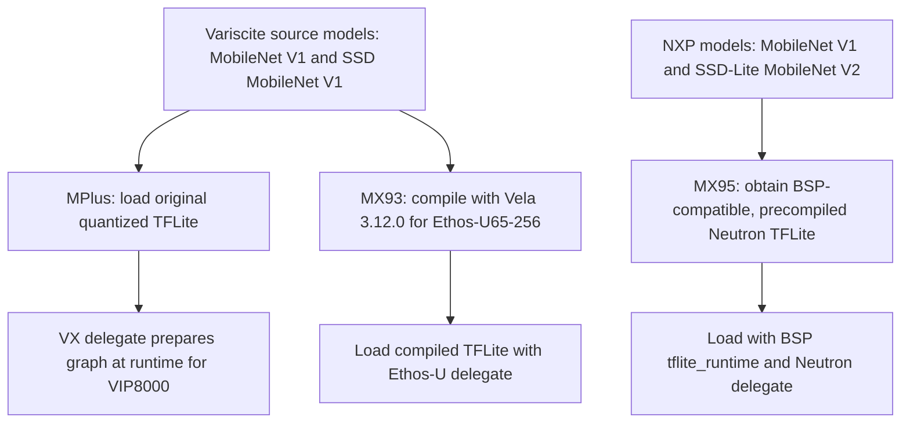
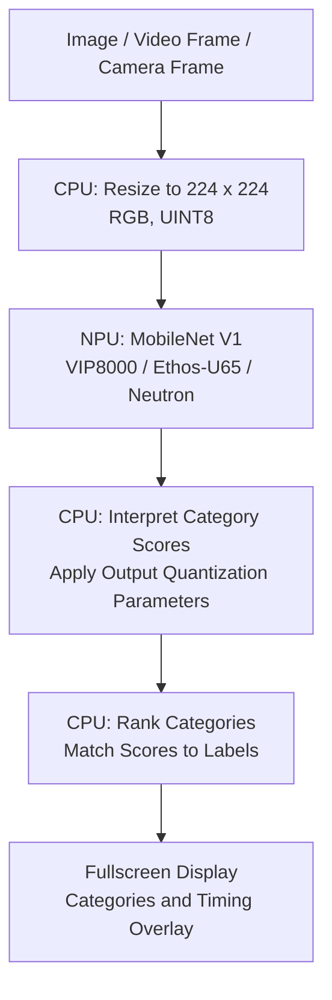
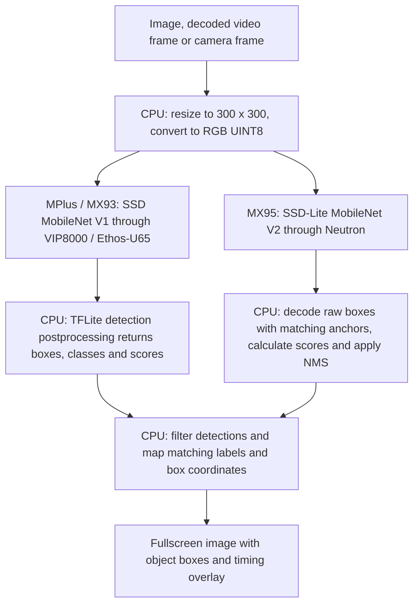

# Models and Processing Flows

[Documentation](README.md) · [Project Overview](../README.md)

Classification identifies the image's main category. Detection finds objects
and draws boxes around them.

## Model Inventory

| Task | Model | Preparation and Details |
| --- | --- | --- |
| Classification | MobileNet V1 1.0 | [Per-board artifacts and conversion](model-conversion.md) |
| Object detection | SSD MobileNet V1 on MPlus/MX93; SSD-Lite MobileNet V2 on MX95 | [Per-board artifacts and conversion](model-conversion.md) |
| Face detection | UltraFace Slim | [Sources, tensors and preparation](face-detection.md) |
| People and vehicle segmentation | DeepLabV3 / MobileNetV2, depth multiplier 0.5 | [Sources and local conversions](segmentation.md) |
| People segmentation | MediaPipe Selfie Segmenter, landscape | [Sources and local conversions](people-segmentation.md) |
| Hand gestures, MPlus only | MediaPipe palm detector and hand landmarks; geometric gesture rules | [Sources and runtime preparation](hand-gestures.md) |

The classification/detection comparison below does not describe the face,
segmentation or hand models; their linked guides record separate contracts.

## Classification and Object Detection

| Model Detail | i.MX 8M Plus | VAR-SOM-MX93 | DART-MX95 |
| --- | --- | --- | --- |
| NPU | VeriSilicon VIP8000 | Arm Ethos-U65-256 | NXP Neutron |
| Delegate | VX | Ethos-U | Neutron |
| Classification Model | MobileNet V1 1.0 | MobileNet V1 1.0 | MobileNet V1 1.0 |
| Classification Input | RGB, 224×224, UINT8 | RGB, 224×224, UINT8 | RGB, 224×224, UINT8 |
| Classification Output | UINT8 scores | UINT8 scores | FLOAT32 scores |
| Detection Model | SSD MobileNet V1 | SSD MobileNet V1 | SSD-Lite MobileNet V2 |
| Detection Input | RGB, 300×300, UINT8 | RGB, 300×300, UINT8 | RGB, 300×300, UINT8 |
| Detection Output | FLOAT32 boxes and scores | FLOAT32 boxes and scores | FLOAT32 raw boxes and scores |
| Model Source | Original Variscite demos | Same source models as MPlus | NXP precompiled models |
| Preparation | Graph prepared at runtime | Compiled with Vela 3.12.0 | Already compiled for Neutron |

For board-specific startup steps, libraries and hardware/software flows,
open [VIP8000](npus/vip8000.md), [Ethos-U65](npus/ethos-u65.md) or
[Neutron](npus/neutron.md).

**Data types:** UINT8 means unsigned 8-bit integers, not signed INT8.
FLOAT32 means 32-bit floating-point values. A 720p or 1080p video is resized
to the model input size above before inference.

**Shared models:** MPlus and MX93 use the same source models. Recompiling
them with Vela reproduced the installed MX93 artifacts byte-for-byte.

**MX95 differences:** its detector is a different model and requires CPU
box decoding/NMS. Its classifier has the same architecture, but identical
weights and preprocessing are not established. The NXP artifacts come from
`lf-6.18.20_2.0.0`; they were not compiled locally with the current SDK.

See [Model Sources and Conversion](model-conversion.md) for download links,
checksums, quantization parameters and conversion commands.

### Where the Models Come From

This suite does not train new models. It installs existing models and prepares
them for the board's NPU. Compilation changes the execution artifact; it
does not mean training a new network.

| Task | MPlus and MX93 Source | MX95 Source | Same Model on All Three? |
| --- | --- | --- | --- |
| Classification | Variscite MobileNet V1 1.0 | NXP MobileNet V1 1.0 | Same architecture, but identical weights and preprocessing are not established for MX95 |
| Detection | Variscite SSD MobileNet V1 | NXP SSD-Lite MobileNet V2 | No. MPlus and MX93 share one source detector; MX95 uses a different detector |

There are **two source detectors, not three independently trained detectors**.
The MPlus and MX93 files differ because their NPU execution paths differ.
The original Variscite models' exact earlier training/export recipe has not
been recovered. The MX95 artifacts are supplied by NXP in
`lf-6.18.20_2.0.0`; we did not compile them locally with the current SDK.
Exact source links, filenames and checksums are in the
[model provenance guide](model-conversion.md#exact-installed-artifacts-and-provenance).

### Model Preparation Flow

This flow applies to both classification and detection. All installed model
files have a `.tflite` extension, but they are not interchangeable between NPUs.

For MX93, the recorded Vela command is
`vela <source-model>.tflite --accelerator-config ethos-u65-256 --output-dir output`.
The reproduced classifier and detector match the installed compiled artifacts
byte-for-byte. VX preparation happens when the MPlus model is first invoked;
it is not a Vela conversion. MX95 uses the NXP-precompiled artifacts rather
than a conversion of the MPlus detector.

### Image, Video and Camera Input Flow

All three input types feed the same task-specific model on each board:

| Input | How Frames Reach the Demo |
| --- | --- |
| Image file | CPU reads the selected still image; no video decoder is needed |
| Video file | GStreamer decodes the selected HD or Full HD clip using the board-specific path below |
| Camera | V4L2 captures frames at the selected camera resolution; no compressed-file decoder is needed |

| SoM | Video File and Decoder | Image Conversion / Scaling |
| --- | --- | --- |
| i.MX 8M Plus | H.264 MP4; `v4l2h264dec`, hardware decoding | `imxvideoconvert_g2d`, using G2D hardware |
| VAR-SOM-MX93 | MJPEG AVI; `jpegdec`, CPU decoding | `imxvideoconvert_pxp`, using PXP hardware |
| DART-MX95 | H.264 MP4; `v4l2h264dec`, hardware decoding | OpenGL/EGL conversion with `glupload`, `glcolorconvert` and `gldownload` |

**AVI, MJPEG and PXP are different things:** AVI is the file container,
MJPEG is the video compression inside it, and PXP is an image-processing
hardware block. On MX93, the CPU decodes MJPEG; PXP converts/scales the
decoded images. PXP is neither a video decoder nor the inference NPU.
This is a compatibility adaptation for the installed BSP, with larger files
and CPU decoding costs compared with the H.264 paths.

The [two supplied Freepik clips](video-sources.md) are the same
content on all boards. MX93 uses converted MJPEG copies; MX95 uses H.264
compatibility copies without B-frames. Video conversion is separate from
model compilation.

MPlus and MX93 video inference can first scale decoded frames to a
display-sized working image with G2D/PXP. The CPU then resizes that image
to the model input. MX95 inference currently keeps its validated native-frame
conversion path by default; accelerated working-size scaling remains
experimental. The player has its own display-scaling path and does not run
an AI model. These differences affect full-pipeline FPS.

### Classification Flow

Classification answers **“What is the main category in this image?”** It
produces category scores, not object boxes. For video and camera, this flow
is repeated for each processed frame.

MPlus/MX93 classifiers return quantized UINT8 scores; MX95 returns FLOAT32
scores. Their input quantization parameters also differ. A common architecture
or UINT8 input does not prove identical predictions.

### Detection Flow

Detection answers **“Which objects are present, and where are they?”** It
produces boxes, categories and confidence scores. The network computation
uses the NPU, but detection postprocessing and drawing still use the CPU.

NMS (non-maximum suppression) removes overlapping duplicate detections.
MX95 must use its matching NXP anchors and COCO labels, not the MPlus
postprocessor. Source videos can be 720p or 1080p, but the detector still
receives 300×300 inputs. Display size, video size and model input size are
three separate dimensions.

**Comparing boards:** inference time measures model execution, not the
entire decoder, preprocessing and display path. MPlus/MX93 share source
models, while MX95 uses a different detector. The pipelines also differ,
so these demo FPS results are not a controlled comparison of NPU speed alone.

## Related Guides

- [Model Sources and Conversion](model-conversion.md): exact source files, checksums, tensor parameters and conversion commands.
- [Video Sources](video-sources.md): clip provenance and MP4/MJPEG compatibility copies.
- [Performance](performance.md): measured FPS versus inference time.
- [SoM Support](som-support.md): available demos and camera resolutions.
